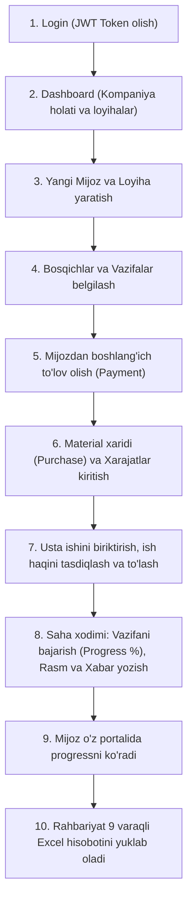

# WorkDex — Frontend Dasturchi uchun To'liq API va Arxitektura Qo'llanmasi 📘

Ushbu qo'llanma **WorkDex — Qurilish va Ta'mirlash Loyihalarini Boshqarish Tizimi** loyihasining rasmiy texnik hujjati (`WorkDex_Loyiha_Hujjati_Ozbekcha.pdf`) asosida ishlab chiqilgan backend API'larini to'liq tushuntirib beradi.

Qo'llanma orqali siz **qaysi API nima uchun yaratilgani**, **PDF dagi qaysi talabni bajarishi**, **frontendda qanday ko'rinishda ishlatilishi** va **tizimning to'liq biznes mantiqini** o'rganasiz.

---

## 📑 Mundarija

1. [Loyiha Falsafasi va Maqsadi](#1-loyiha-falsafasi-va-maqsadi)
2. [Autentifikatsiya, Xavfsizlik va Rollar](#2-autentifikatsiya-xavfsizlik-va-rollar)
3. [Modulma-modul To'liq API Qo'llanmasi](#3-modulma-modul-toliq-api-qollanmasi)
   - [Modul 1: Autentifikatsiya va Foydalanuvchilar (Auth & Users)](#modul-1-autentifikatsiya-va-foydalanuvchilar-auth--users)
   - [Modul 2: Mijozlar Boshqaruvi (Customers)](#modul-2-mijozlar-boshqaruvi-customers)
   - [Modul 3: Loyihalar va Bosqichlar (Projects & Stages)](#modul-3-loyihalar-va-bosqichlar-projects--stages)
   - [Modul 4: Mijoz To'lovlari (Payments)](#modul-4-mijoz-tolovlari-payments)
   - [Modul 5: Xarajatlar Boshqaruvi (Expenses — 7 ta Kategoriya)](#modul-5-xarajatlar-boshqaruvi-expenses--7-ta-kategoriya)
   - [Modul 6: Materiallar va Xaridlar (Materials & Purchases)](#modul-6-materiallar-va-xaridlar-materials--purchases)
   - [Modul 7: Ustalar va Ish haqlari (Workers & Work Payments)](#modul-7-ustalar-va-ish-haqlari-workers--work-payments)
   - [Modul 8: Qo'shimcha Ishlar (Extra Works)](#modul-8-qoshimcha-ishlar-extra-works)
   - [Modul 9: Vazifalar va Avtomatik Progress (Tasks & Progress)](#modul-9-vazifalar-va-avtomatik-progress-tasks--progress)
   - [Modul 10: Hujjatlar, Fotosuratlar va Yangilanishlar (Documents, Photos, Updates)](#modul-10-hujjatlar-fotosuratlar-va-yangilanishlar)
   - [Modul 11: Rahbariyat Dashboardi (Executive Dashboard)](#modul-11-rahbariyat-dashboardi-executive-dashboard)
   - [Modul 12: Mijoz Portali (Customer Portal)](#modul-12-mijoz-portali-customer-portal)
   - [Modul 13: 9 Varaqli Excel Hisobot (Excel Reports)](#modul-13-9-varaqli-excel-hisobot-excel-reports)
4. [Frontend uchun End-to-End Ish Jarayoni (Real Hayotiy Ssenariy)](#4-frontend-uchun-end-to-end-ish-jarayoni)

---

## 1. Loyiha Falsafasi va Maqsadi

Qurilish va ta'mirlash sohasida 4 ta asosiy og'riqli nuqta bor:
1. **Byudjetdan chiqib ketish:** Qancha pul sarflanayotgani vaqtida hisoblanmaydi.
2. **Ustalar hisob-kitobining chalkashishi:** Kim qancha ishladi, qancha olindi, qancha qarz qoldi — daftarda yo'qolib ketadi.
3. **Materiallar nazoratsizligi:** Qaysi materialdan qancha olingani va qayerga ketgani noma'lum.
4. **Mijoz bilan tushunmovchiliklar:** Mijoz ish qanday ketayotganini ko'rmaydi, pul so'ralganda shubha paydo bo'ladi.

**WorkDex** barcha bu jarayonlarni bitta tizimga jamlaydi: rahbariyatga to'liq moliyaviy nazorat beradi, ustalarga haqqoniy hisob yuritadi va mijozga shaffof portal taqdim etadi.

---

## 2. Autentifikatsiya, Xavfsizlik va Rollar

Tizimda **JWT (JSON Web Token)** ishlatiladi. Har bir so'rovda `Header` ga tokenni qo'shish kerak:
```http
Authorization: Bearer <JWT_TOKEN>
```

### 5 ta Foydalanuvchi Roli (PDF §2 talabi):
| Rol (Enum qiymati) | Kim bu? | Nimalarga ruxsati bor? |
|---|---|---|
| **Admin (1)** | Bosh direktor / Tizim egasi | Barcha funksiyalar, o'chirish, tahrirlash, barcha loyihalar, hisobotlar. |
| **ProjectManager (2)** | Loyiha prorabi / Menejer | Loyihalar ochish, bosqich/vazifa qo'shish, material/usta biriktirish, xarajat yozish. |
| **FieldWorker (3)** | Saha xodimi / Nazoratchi | Vazifalarni bajarish (`toggle-complete`), ish joyidan rasm yuklash, kunlik xabar yozish. |
| **Finance (4)** | Buxgalter / Moliyachi | Mijoz to'lovlarini qabul qilish, ustalarga haq to'lash, xarajatlar tahlili, Excel eksport. |
| **Customer (5)** | Uy/Bino egasi (Mijoz) | Faqat o'zining loyihasi progressini, rasmlarini va to'lov balansini ko'rish. |

---

## 3. Modulma-modul To'liq API Qo'llanmasi

---

### Modul 1: Autentifikatsiya va Foydalanuvchilar (Auth & Users)

#### 🎯 PDF dagi talab:
> *"Foydalanuvchilar ro'yxatdan o'tishi, tizimga kirishi va o'z rollariga qarab tizimdan foydalanishi kerak."*

#### 🔌 Endpointlar:

1. **`POST /api/auth/register`** — Yangi xodimni ro'yxatdan o'tkazish
   - **Kimlar uchun:** Ochiq yoki Admin
   - **Request Body:**
     ```json
     {
       "firstName": "Hamidulloh",
       "lastName": "Hakimov",
       "email": "admin@workdex.uz",
       "phoneNumber": "+998901234567",
       "password": "Password123!",
       "role": 1
     }
     ```
   - **Response:** Token, foydalanuvchi ma'lumotlari.

2. **`POST /api/auth/login`** — Tizimga kirish
   - **Request Body:**
     ```json
     {
       "email": "admin@workdex.uz",
       "password": "Password123!"
     }
     ```
   - **Response:** JWT Token (buni Frontend `localStorage` ga saqlaydi).

3. **`GET /api/users/me`** — Joriy kirgan foydalanuvchi profili
   - **Frontendda:** Sayt tepasidagi foydalanuvchi ismi, rasm va rolini chiqarish uchun ishlatiladi.

4. **`GET /api/users`** — Xodimlar ro'yxati (Admin, PM)
   - **Frontendda:** Loyihaga a'zo biriktirish yoki vazifa topshirishda Select/Dropdown ro'yxatida xodimlarni tanlash uchun.

---

### Modul 2: Mijozlar Boshqaruvi (Customers)

#### 🎯 PDF dagi talab (§3 & §14):
> *"Mijoz — bu ta'mirlash xizmatini buyurtma qilgan shaxs. Bir mijoz bir nechta loyihaga ega bo'lishi mumkin."*

#### 🔌 Endpointlar:
- **`GET /api/customers`** — Barcha mijozlar ro'yxati (Jadval / Table).
- **`POST /api/customers`** — Yangi mijoz yaratish:
  ```json
  {
    "fullName": "Ahmad Yusupov",
    "phoneNumber": "+998901112233",
    "email": "ahmad@gmail.com",
    "address": "Toshkent sh., Chilonzor tumani",
    "notes": "Villa egasi"
  }
  ```
- **`GET /api/customers/{id}`** — Mijoz kartochkasi (Mijoz ma'lumotlari + unga tegishli barcha loyihalar ro'yxati).

---

### Modul 3: Loyihalar va Bosqichlar (Projects & Stages)

#### 🎯 PDF dagi talab (§3 & §8):
> *"Har bir loyiha nomi, turi (Villa, Kvartira, Ofis), shartnoma summasi, byudjeti, boshlanish/tugash sanasi va bosqichlariga ega bo'ladi."*

#### 🔌 Endpointlar:

1. **`POST /api/projects`** — Yangi loyiha ochish
   - **Request Body:**
     ```json
     {
       "name": "Ahmad Yusupov — Villa ta'miri",
       "projectType": "Villa renovatsiyasi",
       "customerId": "81e9d025-...",
       "contractAmount": 50000,
       "budget": 35000,
       "currency": "USD",
       "startDate": "2026-08-01T00:00:00Z",
       "endDate": "2026-10-30T00:00:00Z",
       "location": "Toshkent, Chilonzor",
       "notes": "Premium sifatda ta'mir"
     }
     ```

2. **`GET /api/projects`** — Barcha loyihalar ro'yxati (Status, progress %, byudjet ko'rinadi).

3. **`GET /api/projects/{id}/summary`** — **Eng asosiy moliyaviy xulosa API!**
   - **Nima qaytaradi:**
     - `contractAmount`: Umumiy shartnoma + tasdiqlangan qo'shimcha ishlar summasi.
     - `totalPaid`: Mijozdan olingan pul.
     - `remainingPayment`: Mijozdan qolgan qarz.
     - `materialExpenses`, `laborExpenses`, `otherExpenses`, `extraWorkCost`.
     - `totalExpenses`: Jami sarflangan xarajat.
     - `grossProfit`: Sof/Yalpi foyda (`TotalContract - TotalExpenses`).
     - `budgetUtilizationPercent`: Byudjet sarflanish foizi.
   - **Frontendda:** Loyiha sahifasining yuqori qismidagi 4 ta statistik kartochka (Cards) uchun ishlatiladi!

4. **`POST /api/projects/{id}/stages`** — Bosqich qo'shish:
   ```json
   {
     "name": "Demontaj",
     "orderIndex": 1,
     "description": "Eski devor va pollarni buzish"
   }
   ```
5. **`PATCH /api/projects/{id}/stages/{stageId}/complete`** — Bosqichni yakunlash.

---

### Modul 4: Mijoz To'lovlari (Payments)

#### 🎯 PDF dagi talab (§4):
> *"Mijoz to'lovlari shartnoma summasiga qarshi hisoblab boriladi. To'lov usuli (Naqd, Bank, Karta) va qabul qiluvchi qayd etiladi."*

#### 🔌 Endpointlar:
- **`POST /api/projects/{id}/payments`** — To'lov qabul qilish:
  ```json
  {
    "amount": 30000,
    "paymentMethod": 2,
    "paymentDate": "2026-08-18T10:00:00Z",
    "notes": "1-bosqich boshlang'ich to'lovi (Bank o'tkazmasi)"
  }
  ```
  *(PaymentMethod: 1 = Cash, 2 = BankTransfer, 3 = Card, 4 = Other)*
- **`GET /api/projects/{id}/payments`** — Barcha to'lovlar jadvali (Kimdan, qachon, qanday usulda tushdi).

---

### Modul 5: Xarajatlar Boshqaruvi (Expenses — 7 ta Kategoriya)

#### 🎯 PDF dagi talab (§4):
> *"Loyiha xarajatlari qat'iy 7 ta kategoriya bo'yicha yuritiladi."*

#### 7 ta Kategoriya:
1. `Labor` (1) — Usta va mehnat haqi
2. `Material` (2) — Material xarajatlari
3. `Transport` (3) — Transport va logistika
4. `Fuel` (4) — Yoqilg'i
5. `Subcontractor` (5) — Subpudratchilar
6. `Extra` (6) — Qo'shimcha loyiha xarajatlari
7. `Other` (7) — Boshqa xarajatlar

#### 🔌 Endpointlar:
- **`POST /api/projects/{id}/expenses`** — Xarajat kiritish:
  ```json
  {
    "category": 3,
    "amount": 2000,
    "description": "Materiallarni obyektga yetkazib berish (Yuk mashinasi)",
    "expenseDate": "2026-08-18T13:00:00Z",
    "notes": "Chilonzor filialidan"
  }
  ```
- **`GET /api/projects/{id}/expenses?category=3`** — Xarajatlar ro'yxati (kategoriya bo'yicha filtrlash imkoni bilan).

---

### Modul 6: Materiallar va Xaridlar (Materials & Purchases)

#### 🎯 PDF dagi talab (§5):
> *"Materiallar katalogi alohida saqlanadi (birligi bilan). Loyihaga xarid biriktirilganda: 'Kafelga qancha sarfladik?', 'Necha m² oldik?' degan savollarga avtomatik javob chiqishi kerak."*

#### 🔌 Endpointlar:
1. **`GET /api/materials`** & **`POST /api/materials`** — Material katalogi:
   ```json
   { "name": "Ispan kafeli 60x60", "unit": "m²", "description": "Vanna uchun" }
   ```
2. **`POST /api/projects/{id}/material-purchases`** — Loyihaga material sotib olish:
   ```json
   {
     "materialId": "<KAFEL_ID>",
     "quantity": 50,
     "unitPrice": 25,
     "supplier": "Kerama Marazzi",
     "purchaseDate": "2026-08-18T11:00:00Z",
     "receiptNumber": "INV-7890",
     "notes": "1-partiya"
   }
   ```
   > Backend o'zi `totalCost = 50 * 25 = $1,250` ni hisoblaydi!
3. **`GET /api/projects/{id}/materials-summary`** — **Materiallar tahlili API:**
   - Har bir material bo'yicha jami olingan miqdor va jami ketgan pulni jamlab beradi (Donut chart yoki jadval uchun).

---

### Modul 7: Ustalar va Ish haqlari (Workers & Work Payments)

#### 🎯 PDF dagi talab (§6 & §15):
> *"Usta yoki brigadaning loyihada bajargan ishi, kelishilgan summasi, tasdiqlangan bajarilgan ish haqi va unga to'langan summa alohida kuzatiladi."*

#### 🔌 Endpointlar:
1. **`POST /api/workers`** — Usta yaratish (Ismi, telefon, mutaxassisligi: Kafelchi, Santexnik, Malyar).
2. **`POST /api/projects/{id}/worker-payments`** — Ustaga ish biriktirish:
   ```json
   {
     "workerId": "<WORKER_ID>",
     "jobDescription": "Oshxona va vanna kafelini terish",
     "agreedAmount": 3000,
     "workAmount": 0,
     "paidAmount": 0
   }
   ```
3. **`PATCH /api/projects/{id}/worker-payments/{paymentId}/work-amount`** — Bajarilgan ish haqini tasdiqlash:
   - Kafelchi ishning bir qismini tugatdi, qiymati $1,200 deb qabul qilindi:
   ```json
   { "workAmount": 1200, "notes": "Oshxona bitdi" }
   ```
4. **`PATCH /api/projects/{id}/worker-payments/{paymentId}/pay`** — Ustaga pul to'lash:
   ```json
   { "amount": 1000, "paymentDate": "2026-08-18T12:00:00Z", "notes": "Karta orqali" }
   ```
5. **`GET /api/projects/{id}/workers-summary`** — Ustalar balansi:
   - Usta qancha ishladi: `$1,200`. Qancha oldi: `$1,000`. **Qolgan qarzimiz:** `$200` (`RemainingAmount`).

---

### Modul 8: Qo'shimcha Ishlar (Extra Works)

#### 🎯 PDF dagi talab (§7):
> *"Shartnomada bo'lmagan yangi ishlar (masalan: Balkonga elektr montaj). Mijozga aytilgan narx, tannarx va tasdiqlanishi alohida yuritiladi."*

#### 🔌 Endpointlar:
- **`POST /api/projects/{id}/extra-works`** — Qo'shimcha ish yaratish:
  ```json
  {
    "title": "Balkonga qo'shimcha elektr va yoritish montaji",
    "customerAmount": 1500,
    "actualCost": 800,
    "isApprovedByCustomer": true,
    "notes": "Mijoz roziligi olindi"
  }
  ```
  > `ProfitImpact` avtomatik `$1,500 - $800 = +$700` (Foyda).
- **`PATCH /api/projects/{id}/extra-works/{id}/toggle-approval`** — Mijoz tasdig'ini o'zgartirish (Tasdiqlansa, loyiha daromadiga qo'shiladi).

---

### Modul 9: Vazifalar va Avtomatik Progress (Tasks & Progress)

#### 🎯 PDF dagi talab (§8 & §15):
> *"Progress formulasi: Bajarilgan vazifalar og'irligi / Jami vazifalar og'irligi * 100."*

#### 🔌 Endpointlar:
- **`POST /api/projects/{id}/tasks`** — Vazifa qo'shish (og'irligi bilan):
  ```json
  {
    "title": "Devorlarni suvoq qilish",
    "stageId": "<STAGE_ID>",
    "weight": 3,
    "dueDate": "2026-08-25T18:00:00Z"
  }
  ```
- **`PATCH /api/projects/{id}/tasks/{taskId}/toggle-complete`** — Vazifani bajarildi / bajarilmadi qilish.
  - **Avtomatik sehr:** Har safar bu endpoint chaqirilganda, backend loyihaning `ProgressPercent` ini avtomatik qayta hisoblab bazaga yozib qo'yadi!

---

### Modul 10: Hujjatlar, Fotosuratlar va Yangilanishlar

#### 🎯 PDF dagi talab (§12 & §14):
> *"Shartnomalar va cheklar (Hujjatlar). Ish joyidan kunlik rasmlar (Oldin/Keyin) va saha xodimining yangilanish xabarlari."*

#### 🔌 Endpointlar:
1. **Hujjatlar (`/documents`):**
   - `POST /api/projects/{id}/documents` — Fayl yozuvini saqlash (`title`, `filePath`, `fileType`, `fileSizeBytes`).
   - `GET /api/projects/{id}/documents` — Hujjatlar ro'yxati.
2. **Fotosuratlar (`/photos`):**
   - `POST /api/projects/{id}/photos` — Rasm qo'shish (`photoUrl`, `caption`, `isVisibleToCustomer: true/false`, `stageId`).
   - `GET /api/projects/{id}/photos` — Rasmlar galereyasi.
3. **Yangilanish xabarlari (`/updates`):**
   - `POST /api/projects/{id}/updates` — Kunlik yangilik yozish:
     ```json
     { "message": "Bugun 1-qavat kafel ishlari 60% ga bitdi.", "isVisibleToCustomer": true }
     ```

---

### Modul 11: Rahbariyat Dashboardi (Executive Dashboard)

#### 🎯 PDF dagi talab (§9):
> *"Rahbariyat barcha loyihalar bo'yicha jami tushum, xarajat, kutilayotgan pullar va xavf ostidagi loyihalarni bitta ekranda ko'rishi kerak."*

#### 🔌 Endpointlar:
1. **`GET /api/dashboard/stats`** — **Bosh sahifa (Dashboard) uchun asosiy API:**
   ```json
   {
     "totalProjects": 5,
     "activeProjects": 3,
     "completedProjects": 2,
     "totalContractValue": 250000.00,
     "totalRevenueReceived": 180000.00,
     "totalPendingReceivables": 70000.00,
     "totalExpenses": 125000.00,
     "totalNetProfit": 125000.00,
     "averageBudgetUtilizationPercent": 50.00,
     "atRiskProjectsCount": 0
   }
   ```
2. **`GET /api/dashboard/status-distribution`** — Loyihalar holati (Pie/Bar chart uchun).
3. **`GET /api/dashboard/recent-activities`** — Tizimdagi so'nggi harakatlar tasmasi (Timeline).

---

### Modul 12: Mijoz Portali (Customer Portal)

#### 🎯 PDF dagi talab (§13):
> *"Mijoz o'z telefonidan yoki kompyuteridan loyihasining qanday ketayotganini ko'radi. Ichki usta narxlari va material tannarxlari mijozga ko'rinmasligi shart!"*

#### 🔌 Endpoint:
- **`GET /api/portal/projects/{id}`**
  - **Mijoz nimalarni ko'radi:**
    - Loyiha nomi, manzili, boshlanish/tugash sanasi.
    - Shartnoma summasi, to'lagan puli, qolgan to'lov qoldig'i.
    - Umumiy progress % va bosqichlar holati (`Stages`).
    - Faqat mijozga ruxsat berilgan fotosuratlar (`Photos`).
    - Saha yangiliklari xabarlari (`Updates`).
    - Tasdiqlangan qo'shimcha ishlar (`ApprovedExtraWorks`).

---

### Modul 13: 9 Varaqli Excel Hisobot (Excel Reports)

#### 🎯 PDF dagi talab (§16):
> *"Loyiha bo'yicha to'liq 9 ta sahifadan iborat rangli, professional Excel hisoboti yuklab olinishi kerak."*

#### 🔌 Endpointlar:
1. **`GET /api/reports/projects/{id}/excel`** — Muayyan bitta loyiha bo'yicha 9 varaqli Excel yuklab olish:
   - `1. Loyiha haqida`
   - `2. Mijoz To'lovlari`
   - `3. Xarajatlar`
   - `4. Materiallar Xaridi`
   - `5. Usta va Ish haqlari`
   - `6. Qo'shimcha Ishlar`
   - `7. Vazifalar va Progress`
   - `8. Moliyaviy Xulosa`
   - `9. Barcha Loyihalar`
2. **`GET /api/reports/all-projects/excel`** — Kompaniyaning barcha loyihalari umumiy Excel jadvali.

---

## 4. Frontend uchun End-to-End Ish Jarayoni

Frontend dasturini tuzayotganda foydalanuvchi qadamlari qanday bo'ladi:



---

## 🏁 Xulosa

Ushbu backend arxitekturasi:
- **100% to'liq va xatosiz:** Barcha 16 ta jadval va munosabatlar o'zaro bog'langan.
- **Formulalarga asoslangan:** Hech qanday hisob-kitob qo'lda qilinmaydi, backend barcha daromad, xarajat, qarz va progresslarni o'zi hisoblaydi.
- **Frontendga tayyor:** Har bir API frontend dasturchiga kerak bo'ladigan eng qulay JSON formatda ma'lumot qaytaradi.
